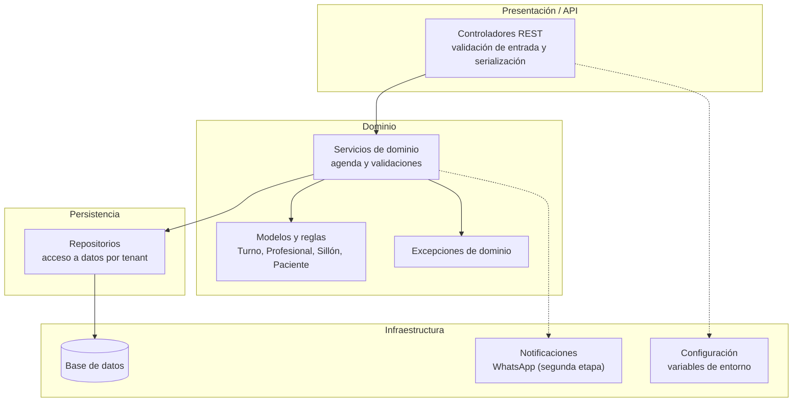

# Arquitectura del Sistema

Este documento describe la arquitectura **objetivo** del producto: cómo se organizan las responsabilidades, cómo se aplica el aislamiento multi-tenant y dónde se ubican las integraciones. Las decisiones y su justificación se registran en [decisions.md](decisions.md).

## 1. Principios

| Principio | Implicancia |
|---|---|
| **Separación de capas** | Presentación, dominio y persistencia tienen responsabilidades distintas y dependencias dirigidas hacia el dominio. |
| **Dominio puro** | Las reglas de agenda y solapamiento no dependen de HTTP, base de datos ni frameworks. |
| **Aislamiento por tenant** | Toda operación se ejecuta dentro de una clínica y nunca mezcla datos entre tenants. |
| **Monolito modular** | Un único despliegue con módulos internos bien delimitados, evitando complejidad distribuida prematura. |
| **Especificación primero** | Los cambios se especifican antes de implementarse, según el flujo SDD/OpenSpec. |
| **Trazabilidad** | Cada regla de negocio debe poder rastrearse a una funcionalidad, una especificación y una prueba. |

## 2. Vista de capas



## 3. Responsabilidades por capa

| Capa | Responsabilidad | No debe hacer |
|---|---|---|
| **Presentación / API** | Recibir la petición, validar el formato, invocar el servicio de dominio y devolver la respuesta. | Contener reglas de solapamiento ni acceder directamente a la base. |
| **Dominio** | Aplicar las reglas de negocio, calcular solapamientos y decidir si un turno es válido. | Depender de HTTP, SQL o frameworks de persistencia. |
| **Persistencia** | Guardar y recuperar entidades, siempre filtrando por tenant. | Decidir reglas de negocio. |
| **Infraestructura** | Resolver base de datos, configuración y mensajería. | Contener lógica de agenda. |

## 4. Módulos internos

| Módulo | Responsabilidad | Funcionalidades asociadas |
|---|---|---|
| **Agenda** | Alta, consulta, cambio de estado y reprogramación de turnos. | `F-01`, `F-02`, `F-03`, `F-09` |
| **Recursos** | Profesionales, sillones, horarios y bloqueos. | `F-04`, `F-05`, `F-10`, `F-12` |
| **Pacientes** | Datos mínimos y asociación con turnos. | `F-11` |
| **Notificaciones** | Eventos internos y recordatorios automáticos (segunda etapa). | `F-07` |
| **Administración** | Configuración del tenant y usuarios; el modelo de usuarios y los parámetros están pendientes (`DP-04`, `DP-06`, `PA-04`). | `F-10`; resto pendiente |

Los módulos comparten el mismo despliegue, pero se comunican a través de servicios de dominio y no por acceso directo a las estructuras internas de otro módulo.

## 5. Modelo multi-tenant

### 5.1. Regla de aislamiento

- Cada clínica o consultorio es un tenant.
- Toda entidad de negocio incluye `tenant_id`.
- Toda consulta y validación se ejecuta con el tenant de la sesión.
- Un turno no puede referenciar profesionales, sillones o pacientes de otro tenant.

### 5.2. Estrategia física

La estrategia de aislamiento físico está pendiente de definición (`DP-03`). Las alternativas posibles —base compartida con `tenant_id`, esquema por tenant u otra— no se adoptan todavía.

### 5.3. Consecuencias

- Los repositorios reciben el tenant como parte del contexto de la operación.
- Las pruebas deben verificar que no haya fuga de datos entre tenants.
- La configuración de la aplicación se externaliza mediante variables de entorno. La dirección arquitectónica es persistir los parámetros específicos de cada tenant en el modelo de datos; el modelo concreto continúa pendiente (`PA-04`, `DP-03`, `DP-10`).

## 6. Flujo de una operación

Ejemplo: alta de un turno desde la API.

1. El controlador recibe `POST /api/v1/turnos` con los datos del turno.
2. Valida el formato de entrada y resuelve el tenant de la sesión.
3. Invoca al servicio de dominio con paciente, profesional, sillón, fecha y horario.
4. El servicio normaliza el intervalo como `[inicio, fin)`.
5. Consulta los turnos activos del mismo tenant, profesional y sillón en la fecha.
6. Aplica `RN-01`, `RN-02` y `RN-09`.
7. Si hay conflicto, lanza `SolapamientoProfesionalError` o `SolapamientoSillonError`; el turno no se persiste.
8. Si no hay conflicto, persiste el turno y devuelve el resultado.
9. La respuesta HTTP definitiva y el mapeo de errores de dominio están pendientes de definición.

El detalle paso a paso está en [flows.md](flows.md).

## 7. Persistencia

| Entorno | Tecnología | Estado |
|---|---|---|
| Desarrollo y pruebas | SQLite | Definido en [decisions.md](decisions.md) |
| Producción | Pendiente | `DP-02` |

Los repositorios abstraen el acceso a datos para que el dominio no dependa de la tecnología elegida. La validación de solapamiento debe ejecutarse de forma consistente aun con altas concurrentes; la estrategia transaccional está pendiente (`DP-05`).

## 8. Integraciones

| Integración | Ubicación | Etapa | Observaciones |
|---|---|---|---|
| API REST/JSON | Capa de presentación | MVP | Contrato definitivo pendiente |
| WhatsApp | Infraestructura / notificaciones | Segunda etapa | Proveedor y condiciones pendientes (`DP-09`) |
| AFIP/ARCA | Infraestructura / administración | Futuro | Fuera del MVP (`PA-03`) |
| Medios de pago locales | Infraestructura / administración | No comprometido | Oportunidad de mercado (`PA-09`) |

Las integraciones externas no deben bloquear el alta de turnos: la reserva se confirma con las reglas de dominio y la notificación se procesa como evento posterior.

## 9. Estructura objetivo de directorios

La siguiente estructura es una **propuesta sujeta a validación**, no una decisión cerrada:

```text
src/
├── domain/          # modelos, servicios y excepciones de dominio
├── api/             # controladores y esquemas de entrada/salida
├── repositories/    # acceso a datos por tenant
└── infrastructure/  # base de datos, configuración y mensajería
tests/
├── unit/            # reglas de dominio
└── integration/     # API, persistencia e integraciones
```

La organización definitiva depende de `DP-01` y `DP-02`.

## 10. Atributos de calidad

| Atributo | Objetivo | Cómo se sostiene |
|---|---|---|
| **Consistencia de reservas** | Evitar doble reserva de profesional o sillón. | Validación de dominio y estrategia de concurrencia (`DP-05`). |
| **Aislamiento** | Ningún tenant ve datos de otro. | `tenant_id` en entidades, consultas y pruebas. |
| **Mantenibilidad** | Cambiar reglas sin reescribir la API. | Dominio puro y separación de capas. |
| **Testabilidad** | Probar reglas sin base de datos ni HTTP. | Servicios de dominio independientes. |
| **Trazabilidad** | Vincular regla, spec, código y prueba. | Convención de IDs y flujo SDD. |

No se definen objetivos de performance, disponibilidad o escalabilidad hasta que exista una medición o un requisito concreto.

## 11. Seguridad

- El aislamiento por tenant es una regla de arquitectura, no solo una validación de interfaz.
- Las credenciales y secretos se configuran por variables de entorno, nunca en el repositorio.
- La autenticación, autorización y gestión de sesiones están pendientes de definición (`DP-04`).
- Los datos de ejemplo deben ser sintéticos (`RN-06`).

## 12. Documentos relacionados

- [decisions.md](decisions.md) — decisiones y justificación.
- [business-rules.md](business-rules.md) — reglas que la arquitectura debe sostener.
- [data-models.md](data-models.md) — entidades y relaciones.
- [features.md](features.md) — operaciones expuestas.
- [open-questions.md](open-questions.md) — definiciones pendientes.
