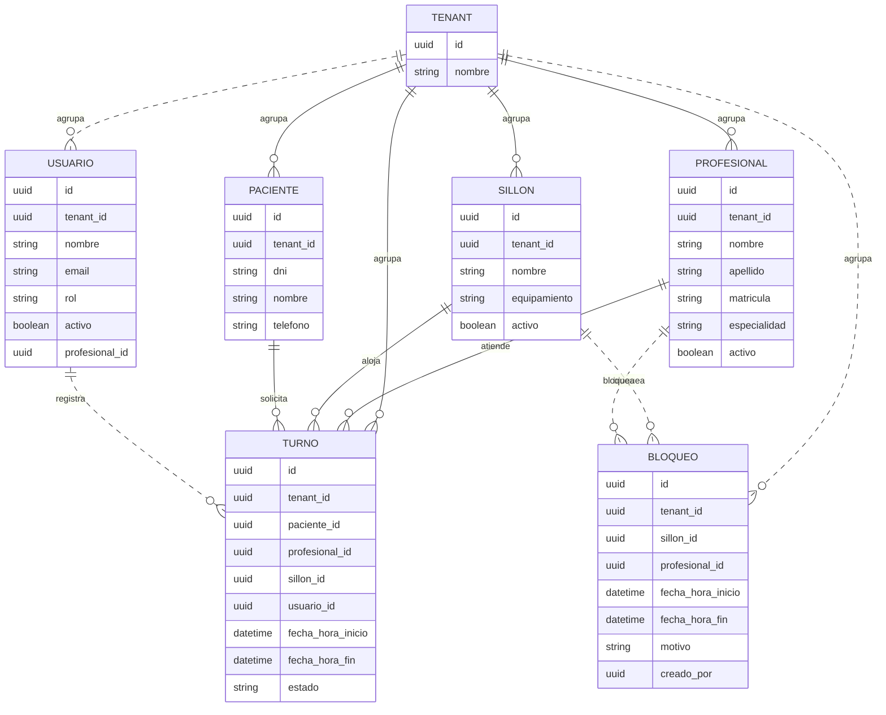

# Modelo de Datos

Este documento describe el modelo de datos **objetivo** del producto. Las entidades, relaciones e invariantes son independientes de la tecnología de persistencia, que se define en [decisions.md](decisions.md).

## 1. Principios

- **Aislamiento por tenant:** toda entidad de negocio incluye `tenant_id` y pertenece a una única clínica.
- **Integridad referencial:** un turno referencia entidades existentes del mismo tenant.
- **Intervalos semiabiertos:** el turno se modela con `fecha_hora_inicio` y `fecha_hora_fin` y se interpreta como `[inicio, fin)`.
- **Estados explícitos:** el estado del turno es un valor enumerado, no texto libre.
- **Datos sintéticos:** los ejemplos y datos iniciales usan nombres ficticios.

## 2. Entidades

### 2.1. Tenant

Representa una clínica o consultorio aislado dentro del SaaS.

| Campo | Tipo | Descripción | Definición |
|---|---|---|---|
| `id` | UUID / Integer | Identificador del tenant | Tipo pendiente (`DP-06`) |
| `nombre` | String | Nombre de la clínica o consultorio | Definido |
| `estado` | Enum | Situación del tenant | Pendiente de definición |

Los campos de configuración, facturación y onboarding del tenant están pendientes de definición (`PA-04`).

### 2.2. Profesional

Odontólogo matriculado que atiende turnos.

| Campo | Tipo | Descripción | Definición |
|---|---|---|---|
| `id` | UUID / Integer | Identificador | Tipo pendiente (`DP-06`) |
| `tenant_id` | FK → Tenant | Clínica a la que pertenece | Definido |
| `nombre` | String | Nombre | Definido |
| `apellido` | String | Apellido | Definido |
| `matricula` | String | Matrícula profesional | Definido |
| `especialidad` | String | Especialidad odontológica | Definido |
| `activo` | Boolean | Indica si puede asignarse a nuevos turnos | Pendiente (`PA-16`) |

### 2.3. Sillón / Box

Recurso físico donde se realiza la atención.

| Campo | Tipo | Descripción | Definición |
|---|---|---|---|
| `id` | UUID / Integer | Identificador | Tipo pendiente (`DP-06`) |
| `tenant_id` | FK → Tenant | Clínica a la que pertenece | Definido |
| `nombre` | String | Nombre visible, por ejemplo "Sillón 1 - Cirugía" | Definido |
| `equipamiento` | String | Equipamiento disponible | Definido |
| `activo` | Boolean | Indica si puede asignarse a nuevos turnos | Definido |

### 2.4. Paciente

Persona que recibe la atención.

| Campo | Tipo | Descripción | Definición |
|---|---|---|---|
| `id` | UUID / Integer | Identificador | Tipo pendiente (`DP-06`) |
| `tenant_id` | FK → Tenant | Clínica a la que pertenece | Definido |
| `dni` | String | Documento de identidad | Definido |
| `nombre` | String | Nombre del paciente | Definido |
| `telefono` | String | Teléfono de contacto | Definido |

El alta y la consulta son parte del MVP (`F-11`), pero sus endpoints y el eventual portal del paciente están pendientes de definición (`PA-05`).

### 2.5. Turno

Reserva temporal que relaciona paciente, profesional y sillón.

| Campo | Tipo | Descripción | Definición |
|---|---|---|---|
| `id` | UUID / Integer | Identificador | Tipo pendiente (`DP-06`) |
| `tenant_id` | FK → Tenant | Clínica a la que pertenece | Definido |
| `paciente_id` | FK → Paciente | Paciente atendido | Definido |
| `profesional_id` | FK → Profesional | Profesional que atiende | Definido |
| `sillon_id` | FK → Sillón | Sillón asignado | Definido |
| `usuario_id` | FK → Usuario | Usuario que registró o modificó el turno | Pendiente (`DP-04`, `DP-06`) |
| `fecha_hora_inicio` | DateTime | Inicio del intervalo | Definido |
| `fecha_hora_fin` | DateTime | Fin del intervalo (exclusivo) | Definido |
| `estado` | Enum | Estado del turno | Definido |

### 2.6. Usuario

Actor autenticado que opera la plataforma. Su modelo definitivo depende de `DP-04`.

| Campo | Tipo | Descripción | Definición |
|---|---|---|---|
| `id` | UUID / Integer | Identificador | Tipo pendiente (`DP-06`) |
| `tenant_id` | FK → Tenant | Clínica a la que pertenece | Definido |
| `nombre` | String | Nombre visible | Definido |
| `email` | String | Identificador de acceso | Pendiente (`DP-04`) |
| `rol` | Enum | `Administrador`, `Recepcionista` o `Profesional` | Pendiente (`DP-04`) |
| `activo` | Boolean | Indica si puede iniciar sesión | Pendiente (`DP-04`) |
| `profesional_id` | FK → Profesional | Vínculo cuando el rol es profesional | Pendiente (`DP-04`) |

La autenticación, las sesiones y la relación exacta entre usuario y profesional están pendientes (`DP-04`).

### 2.7. Bloqueo

Entidad propuesta para representar un recurso fuera de servicio. No reemplaza al `Turno` y su definición está pendiente (`PA-15`).

| Campo | Tipo | Descripción | Definición |
|---|---|---|---|
| `id` | UUID / Integer | Identificador | Tipo pendiente (`DP-06`) |
| `tenant_id` | FK → Tenant | Clínica a la que pertenece | Definido |
| `sillon_id` | FK → Sillón | Sillón bloqueado | Pendiente (`PA-15`) |
| `profesional_id` | FK → Profesional | Profesional bloqueado, si aplica | Pendiente (`PA-15`) |
| `fecha_hora_inicio` | DateTime | Inicio del bloqueo | Pendiente (`PA-15`) |
| `fecha_hora_fin` | DateTime | Fin del bloqueo | Pendiente (`PA-15`) |
| `motivo` | String | Motivo del bloqueo | Pendiente (`PA-15`) |
| `creado_por` | FK → Usuario | Usuario que registró el bloqueo | Pendiente (`DP-04`) |

> Alternativa: representar el bloqueo como un `Turno` sin paciente. La decisión está abierta (`PA-15`).

## 3. Relaciones

| Relación | Cardinalidad | Descripción |
|---|---|---|
| Tenant → Profesional | 1 : N | Un tenant agrupa varios profesionales. |
| Tenant → Sillón | 1 : N | Un tenant agrupa varios sillones. |
| Tenant → Paciente | 1 : N | Un tenant agrupa varios pacientes. |
| Tenant → Turno | 1 : N | Un tenant agrupa todos sus turnos. |
| Profesional → Turno | 1 : N | Un profesional puede tener muchos turnos. |
| Sillón → Turno | 1 : N | Un sillón puede alojar muchos turnos a lo largo del tiempo. |
| Paciente → Turno | 1 : N | Un paciente puede tener muchos turnos. |
| Tenant → Usuario | 1 : N | Un tenant agrupa varios usuarios. |
| Tenant → Bloqueo | 1 : N | Un tenant agrupa sus bloqueos. |
| Usuario → Turno | 1 : N | Un usuario registra muchos turnos. |
| Sillón → Bloqueo | 1 : N | Un sillón puede tener varios bloqueos. |
| Profesional → Bloqueo | 1 : N | Un profesional puede tener bloqueos, si se modelan. |

### 3.1. Diagrama entidad-relación

> El tipo `uuid` del diagrama es ilustrativo. La definición entre UUID e Integer está pendiente (`DP-06`). Las relaciones punteadas y las entidades `USUARIO` y `BLOQUEO` son propuestas pendientes (`DP-04`, `PA-15`, `PA-16`).

## 4. Enumeraciones

### 4.1. Estado del turno

| Valor | Significado | Bloquea recursos |
|---|---|---|
| `PENDIENTE` | Turno registrado a la espera de confirmación. | Sí |
| `CONFIRMADO` | Turno confirmado para la atención. | Sí |
| `CANCELADO` | Turno anulado por el paciente o la clínica. | No |
| `COMPLETADO` | Atención finalizada. | No |

## 5. Invariantes

1. **Pertenencia al tenant:** todas las entidades de un turno comparten el mismo `tenant_id`.
2. **Integridad referencial:** `paciente_id`, `profesional_id` y `sillon_id` deben existir.
3. **Intervalo válido:** se propone que `fecha_hora_fin` sea posterior a `fecha_hora_inicio`; la validación formal de duraciones cero o negativas está pendiente (`RP-01`).
4. **Sin solapamiento:** no puede existir otro turno activo con el mismo `profesional_id` o el mismo `sillon_id` en un intervalo que se solape.
5. **Estado válido:** `estado` solo puede tomar los valores de la enumeración.
6. **Liberación por cancelación:** un turno `CANCELADO` no participa de la validación de solapamiento.
7. **Sillón activo:** un sillón con `activo = false` no debería recibir nuevos turnos; el comportamiento exacto está pendiente (`PA-01`, `PA-16`).
8. **Autoría:** toda acción que crea o modifica un turno debe registrar un `usuario_id`; el mecanismo está pendiente (`DP-04`, `DP-06`).
9. **Bloqueo:** un bloqueo no debería solaparse con turnos activos del mismo recurso, salvo que `RP-07` defina lo contrario.

## 6. Datos de ejemplo

Todos los datos son sintéticos y no representan personas reales.

| Entidad | Ejemplo |
|---|---|
| Tenant | `Clínica Ejemplo` |
| Profesional | `Dr. Pérez`, matrícula `MP-0000`, especialidad `Odontología general` |
| Sillón | `Sillón 1`, equipamiento `Unidad dental completa`, activo |
| Paciente | `Paciente A`, DNI `00000000`, teléfono `000-0000000` |
| Turno | `2026-11-01 10:00` a `2026-11-01 10:30`, estado `CONFIRMADO` (valor de la especificación vigente; el estado inicial del alta sigue pendiente, `PA-13`) |

## 7. Decisiones pendientes del modelo

| ID | Tema | Impacto |
|---|---|---|
| `DP-06` | Tipo de identificadores, timestamps, auditoría y borrado lógico. | Diseño de tablas y migraciones |
| `DP-08` | Entidad de disponibilidad/horarios por profesional y sillón. | Cálculo de disponibilidad real |
| `PA-15` | Modelo definitivo del turno de bloqueo. | Bloqueo de recursos y validación de disponibilidad |
| `PA-16` | Baja lógica o inactivación de profesionales y sillones. | Integridad de turnos futuros |
| `PA-05` | Entidad definitiva de paciente y eventual portal. | Alcance del módulo de pacientes |
| `PA-12` | Retención y tratamiento de datos. | Cumplimiento y privacidad |
| `DP-03` | Estrategia de aislamiento multi-tenant. | Modelo físico de datos |

## 8. Documentos relacionados

- [business-rules.md](business-rules.md) — reglas que el modelo debe sostener.
- [architecture.md](architecture.md) — ubicación del modelo y la persistencia.
- [decisions.md](decisions.md) — decisiones y pendientes técnicos.
- [features.md](features.md) — operaciones que usan estas entidades.
