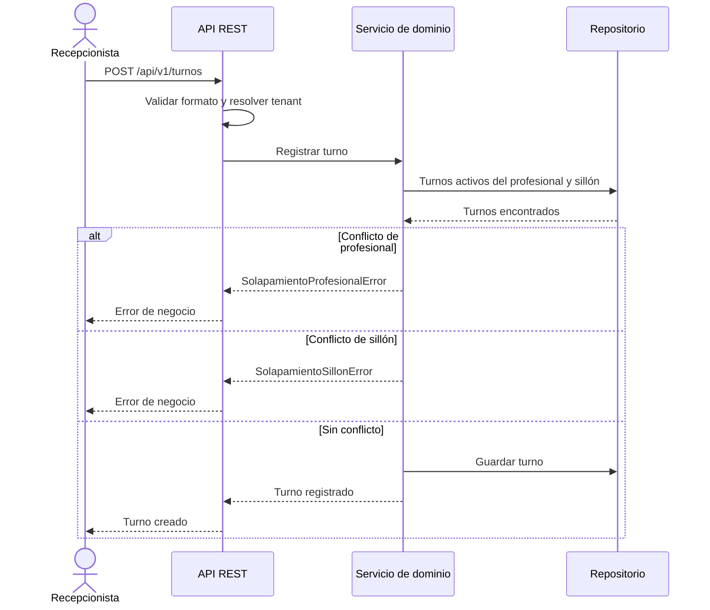
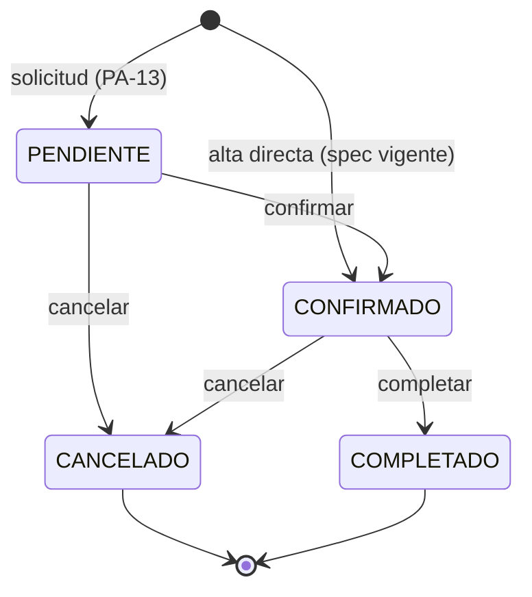

# Flujos del Sistema y Notificaciones

Este documento describe los flujos extremo a extremo del producto. Cada flujo indica actor, disparador, precondiciones, pasos, alternativas y postcondiciones. Las reglas aplicadas se definen en [business-rules.md](business-rules.md) y las funcionalidades en [features.md](features.md).

## 1. Convenciones

- Los horarios se interpretan como intervalos semiabiertos `[inicio, fin)`.
- Los datos de los ejemplos son sintéticos.
- La etapa indica cuándo se espera construir el flujo: `MVP`, `Segunda etapa` o `Futuro`.
- Los pasos marcados como pendientes no forman parte del comportamiento definido.

## 2. Flujo de creación de turno

**Actor:** Recepcionista.
**Etapa:** MVP.
**Disparador:** un paciente solicita un turno presencial o telefónico.

### 2.1. Precondiciones

- El paciente existe en el tenant.
- El profesional y el sillón existen en el tenant.
- El estado activo/inactivo del sillón se evalúa según `PA-01`, `PA-16`.
- La fecha y el horario están definidos.

### 2.2. Pasos

1. La recepcionista selecciona paciente, profesional, sillón, fecha y horario.
2. El sistema resuelve el tenant de la sesión.
3. Valida los datos mínimos y la coherencia del intervalo. El detalle de esta validación está pendiente (`RP-01`).
4. Normaliza el intervalo como `[inicio, fin)`.
5. Recupera los turnos activos del mismo tenant para la fecha, el profesional y el sillón.
6. Aplica `RN-01`: verifica al profesional y al sillón de forma independiente.
7. Aplica `RN-02`: descarta como conflicto los turnos contiguos.
8. Si existe conflicto, aplica `RN-09` y lanza la excepción correspondiente.
9. Si no existe conflicto, registra el turno.
10. Devuelve el turno creado.

### 2.3. Alternativas

| Situación | Resultado |
|---|---|
| El profesional está ocupado | `SolapamientoProfesionalError`; no se registra el turno. |
| El sillón está ocupado | `SolapamientoSillonError`; no se registra el turno. |
| Ambos están ocupados | `SolapamientoProfesionalError` por `RN-09`. |
| El horario es contiguo a otro turno | Se permite. |
| Los datos son inválidos | Se rechaza; la validación exacta está pendiente (`RP-01`). |
| El sillón está inactivo | Comportamiento pendiente (`PA-01`, `PA-16`); se propone rechazar la asignación. |

### 2.4. Postcondiciones

- El turno queda registrado con un estado inicial que sigue pendiente de definición (`PA-13`): la especificación vigente usa `CONFIRMADO`, mientras que el ciclo de vida contempla `PENDIENTE`.
- El profesional y el sillón quedan bloqueados para ese intervalo.
- El turno puede consultarse y cambiar de estado según `RN-03`.

### 2.5. Diagrama de secuencia

## 3. Flujo de cambio de estado

**Actor:** Recepcionista para confirmar y cancelar. La finalización queda pendiente de asignación de rol.
**Etapa:** MVP.
**Disparador:** confirmación, cancelación o finalización de la atención.

### 3.1. Transiciones

| Acción | Origen | Destino | Efecto |
|---|---|---|---|
| Confirmar | `PENDIENTE` | `CONFIRMADO` | Mantiene bloqueados los recursos. |
| Cancelar | `PENDIENTE` o `CONFIRMADO` | `CANCELADO` | Libera profesional y sillón. |
| Completar | `CONFIRMADO` | `COMPLETADO` | Cierra la atención y libera los recursos. |

### 3.2. Pasos

1. La recepcionista identifica el turno.
2. El sistema verifica que el turno pertenece al tenant.
3. Verifica que la transición solicitada sea válida según `RN-03`.
4. Aplica el nuevo estado.
5. Si el estado es `CANCELADO`, libera ambos recursos (`RN-04`).
6. Si el estado es `COMPLETADO`, cierra la atención y el turno deja de considerarse activo; los recursos quedan disponibles para intervalos posteriores (`RN-03`).
7. Devuelve el turno actualizado.

### 3.3. Alternativas

- Transición no permitida: se rechaza y el turno conserva su estado.
- Turno inexistente o de otro tenant: se rechaza.

### 3.4. Diagrama de estados

> El estado inicial está pendiente de definición (`PA-13`). El diagrama muestra las dos alternativas documentadas.

## 4. Flujo de cancelación y liberación

**Actor:** Recepcionista.
**Etapa:** MVP.
**Disparador:** el paciente o la clínica cancela el turno.

### 4.1. Pasos

1. La recepcionista identifica el turno.
2. El sistema valida que el turno esté en `PENDIENTE` o `CONFIRMADO`.
3. Cambia el estado a `CANCELADO`.
4. El turno deja de participar en la validación de solapamiento.
5. El profesional y el sillón quedan disponibles para ese intervalo.
6. Se conserva el registro del turno como historial.

### 4.2. Postcondiciones

- El turno cancelado no bloquea nuevas reservas.
- El historial permite saber que el turno existió y fue cancelado.
- La política de cancelación —plazos, motivos y efectos— está pendiente (`PA-06`, `RP-04`).

## 5. Flujo de reprogramación

**Actor:** Recepcionista.
**Etapa:** MVP, con mecanismo pendiente de definición.

### 5.1. Comportamiento esperado

1. La recepcionista selecciona un turno existente.
2. Indica el nuevo horario, profesional o sillón.
3. El sistema valida el nuevo intervalo con `RN-01` y `RN-02`.
4. Si el nuevo horario es válido, se registra el cambio.
5. El horario anterior queda liberado.
6. Se conserva la trazabilidad del cambio.

### 5.2. Pendiente de definición

- ¿Se implementa como cancelación + alta o como modificación del turno? (`RP-03`)
- ¿Qué ocurre si el nuevo horario genera conflicto?
- ¿Cómo se registra el historial de reprogramaciones?
- ¿Qué endpoint y contrato se utilizan?

## 6. Flujo de notificaciones y recordatorios

**Actor:** Sistema.
**Etapa:** Segunda etapa.
**Disparador:** alta o confirmación de un turno; proximidad de la fecha de atención.

### 6.1. Pasos previstos

1. El sistema detecta un evento de turno: alta, confirmación o proximidad de la cita.
2. Genera el mensaje correspondiente.
3. Envía el mensaje por WhatsApp.
4. El paciente puede confirmar o cancelar desde el mensaje.
5. Si confirma, el turno se mantiene en su estado actual o se registra la confirmación de asistencia, según se defina (`PA-11`).
6. Si cancela, se aplica el flujo de cancelación y se liberan los recursos.

### 6.2. Objetivo

Reducir la tasa de ausentismo mediante avisos oportunos y acciones simples para el paciente.

### 6.3. Pendiente de definición

- Proveedor de WhatsApp y condiciones comerciales (`DP-09`).
- Momentos de envío: antes del turno y reintentos (`PA-11`).
- Plantillas y textos.
- Opt-in y baja de notificaciones.
- Tratamiento de errores de envío.
- Estado exacto del turno cuando el paciente confirma.

## 7. Flujo de agenda y visualización

**Actor:** Recepcionista o Profesional.
**Etapa:** Segunda etapa para la vista matricial; el MVP incluye consulta de turnos.

### 7.1. Comportamiento previsto

- Matriz visual organizada por profesional y por sillón/box.
- Estados diferenciados por color.
- Indicación explícita ante intentos de solapamiento.
- Filtros por fecha y recurso.

### 7.2. Pendiente de definición

- Granularidad de la grilla (por hora, por franja, por turno).
- Columnas y filas exactas.
- Colores y leyenda.
- Comportamiento en pantallas pequeñas.
- Permisos de visualización del profesional.

## 8. Flujo de bloqueo de sillón por mantenimiento

**Actor:** Administrador.
**Etapa:** MVP (propuesta pendiente de validación).
**Disparador:** el sillón requiere mantenimiento o deja de estar disponible.
**Estado:** flujo previsto; el mecanismo no está modelado (`PA-15`, `PA-16`).

### 8.1. Alternativas previstas

| Mecanismo | Descripción |
|---|---|
| Turno de bloqueo | Se registra un turno que ocupa el intervalo afectado; el modelo está pendiente (`PA-15`). |
| Inactivación del sillón | El recurso se marca como inactivo y no se ofrece para nuevas reservas; la baja lógica está pendiente (`PA-16`). |

### 8.2. Pasos

1. El administrador identifica el sillón y el intervalo afectado.
2. Elige el mecanismo de bloqueo que se defina.
3. El sistema impide asignar el sillón a nuevos turnos en ese intervalo.
4. Al finalizar el mantenimiento, se libera el bloqueo o se reactiva el sillón.

### 8.3. Pendiente de definición

- Modelo del turno de bloqueo (`PA-15`).
- Baja lógica o inactivación de recursos (`PA-16`).
- Si se requiere una autorización adicional a la del administrador.
- Cómo se visualiza en la agenda.
- Qué ocurre con los turnos ya asignados (`RP-07`).
- Cómo se registra el motivo (`PA-01`).

## 9. Documentos relacionados

- [features.md](features.md) — funcionalidades que originan los flujos.
- [business-rules.md](business-rules.md) — reglas aplicadas en cada paso.
- [actors.md](actors.md) — permisos de los actores.
- [open-questions.md](open-questions.md) — definiciones pendientes.
